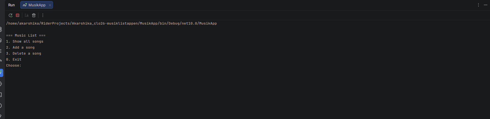

# Musiklistappen — Akarshika Srivastava


## Vad appen gör

Det här är en konsolapp i C# som hanterar Taylor Swifts musik i en SQLite-databas. Databasen innehåller artister, album (Fearless, 1989, Red (Taylor's Version) och folklore) och låtar. I en numrerad meny kan man:

- visa alla låtar med artist, album och längd
- lägga till en ny låt
- ta bort en låt (appen frågar "Are you sure? y/n" först)
- visa låtar som är längre än medellängden

## Så kör du den

```bash
git clone [länk till din fork]
cd [mappens namn]/MusikApp
dotnet run
```

[Skriv här om något behöver göras först, t.ex. att `musik.db` ska ligga i mappen `MusikApp/`.]

## Så ser huvudmenyn ut



---

## Mina designval (VG)

*Fyll i det här avsnittet om du siktar på VG. Annars kan du ta bort det.*

1. **Hur designade du din databas? Varför valde du just den strukturen?**

 Min databas har fem tabeller: `artists`, `albums`, `songs`, `genres` och `song_genres`. En artist kan ha många album och ett album kan ha många låtar. Därför kopplade jag ihop dem med främmande nycklar (`artist_id` i `albums` och `album_id` i `songs`). En låt kan ha flera genrer och en genre kan höra till många låtar, så där behövdes en kopplingstabell, `song_genres`. Jag valde den här strukturen för att slippa upprepa samma information. Artistens namn finns till exempel bara på ett ställe i stället för på varje låt.


2. **Vilket SQL-krav valde du (JOIN eller subquery) och varför passade det din app?**

 Jag använde båda. I `GetAllSongs()` använder jag en JOIN mellan `songs`, `albums` och `artists`. Tabellen `songs` har bara ett `album_id`, så utan JOIN skulle appen bara kunna visa siffror. Med JOIN kan den visa albumets titel och artistens namn. I `GetSongsLongerThanAverage()` använder jag en subquery: `WHERE length_seconds > (SELECT AVG(length_seconds) FROM songs)`. Den passade bra eftersom databasen själv räknar ut medellängden, så jag slipper göra det i C#.
 
3. **Vad skulle du gjort annorlunda om du byggde om den från scratch?**

 Jag skulle planera databasen och menyn bättre innan jag började koda. Jag skulle också lägga till en sökfunktion, så att man kan hitta en låt genom att skriva en del av titeln. Dessutom skulle jag göra menyn snyggare och tydligare, med fler meddelanden som förklarar vad man ska skriva.
